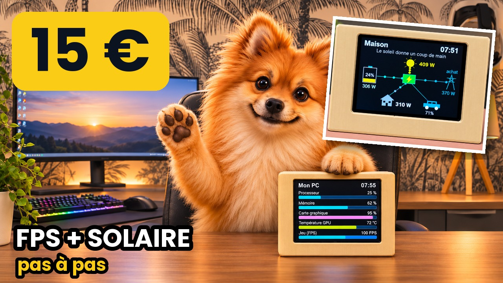

# Écran de bureau ESP32 à 15 € : mon PC + ma maison solaire

🇬🇧 [English version](README.md)

🎬 La vidéo tuto pas à pas : [Cet écran à 15 € affiche mes FPS… et ma batterie solaire](https://youtu.be/b4XATOMQBNA)

Un écran tactile **ESP32-2432S028** (« Cheap Yellow Display », environ 15 €) posé sous l'écran du PC. Il affiche 3 pages, qu'on change en touchant l'écran :

| Page | Ce qu'elle montre |
|---|---|
| **Mon PC** | processeur, mémoire, carte graphique, température GPU, FPS du jeu |
| **Maison** | production solaire, batteries, réseau, maison, voiture, avec des flux animés |
| **Horloge** | l'heure, la date et la production solaire |

## Ce qu'il faut
- Un écran **ESP32-2432S028** et un câble USB-C qui transmet les données.
- **Home Assistant** avec les applications **Mosquitto broker** et **ESPHome Device Builder**.
- Sur le PC : **HASS.Agent** et **HWiNFO** (gratuits). Les commandes fournies utilisent `nvidia-smi` : carte graphique **NVIDIA**.
- Le boîtier incliné, à imprimer en 3D : `boitier-cyd-incline.zip` (fichier STL, imprimé couché, sans supports particuliers).

## Les fichiers
| Fichier | À quoi il sert |
|---|---|
| `cyd-bureau.yaml` | Le programme de l'écran, à coller dans ESPHome |
| `secrets-exemple.yaml` | Les lignes à ajouter dans les Secrets d'ESPHome (Wi-Fi) |
| `capteurs-hass-agent.txt` | Les 5 capteurs HASS.Agent, avec les commandes à copier, et le réglage HWiNFO |
| `boitier-cyd-incline.zip` | Le boîtier 3D (STL) |

## Les étapes (détaillées dans la vidéo)
1. Home Assistant : Paramètres › Applications › **Mosquitto broker** › Installer › Démarrer, puis créer un utilisateur `mqtt` (Paramètres › Personnes › Utilisateurs).
2. PC : installer **HASS.Agent** et le relier à Home Assistant (onglet MQTT : adresse, port 1883, utilisateur mqtt).
3. HASS.Agent › Capteurs : créer les 5 capteurs de `capteurs-hass-agent.txt`.
4. **HWiNFO** : Capteurs seulement ; Paramètres › HWiNFO Gadget › « Fréquence d'images Presented (avg) » › Valeur du rapport dans Gadget ; démarrage automatique.
5. Home Assistant : Paramètres › Appareils et services › MQTT : le PC apparaît avec ses 5 capteurs. Notez leurs noms.
6. Paramètres › Applications › **ESPHome Device Builder** › Installer.
7. ESPHome › Nouvel appareil › ESP32 › Éditer : coller `cyd-bureau.yaml`, puis **remplacer les noms des capteurs en haut du fichier par les vôtres**. Dans Secrets, ajouter votre Wi-Fi.
8. Premier flash en USB : Installer › Téléchargement manuel, puis **web.esphome.io** › Connecter › Installer.
9. Home Assistant détecte l'écran : Paramètres › Appareils et services › Configurer.

## Les 3 pièges
- **Image en miroir** : `mirror_x` / `mirror_y` dans la partie `transform`.
- **Couleurs inversées** (rouge et bleu) : `color_order: rgb` ou `bgr` selon la dalle.
- **Écran trop sombre la nuit** : `lum_nuit` en haut du fichier (45 % par défaut).

Les pages « Maison » et « Horloge » utilisent mes propres capteurs solaires (onduleur Deye, batteries JK-BMS, borne V2C Trydan) : remplacez-les par les vôtres, ou supprimez les lignes qui ne vous concernent pas.
