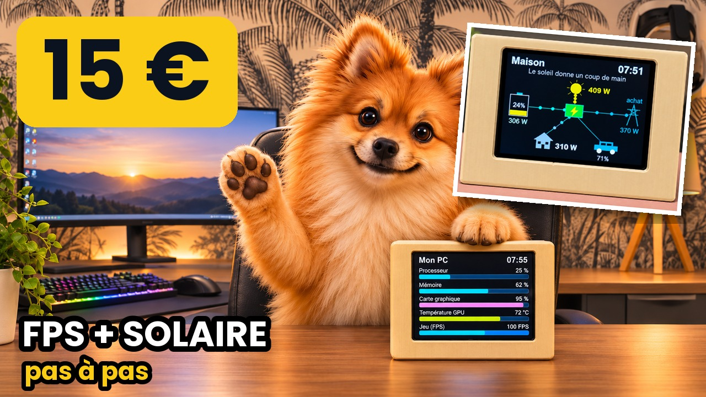

# $15 ESP32 desk screen: my PC + my solar home

🇫🇷 [Version française](LISEZMOI.md)

🎬 Step-by-step video (in French, English title and description): [This $15 screen shows my game FPS… and my solar battery](https://youtu.be/b4XATOMQBNA)

An **ESP32-2432S028** touch screen ("Cheap Yellow Display", about $15) sitting under the PC monitor. Tap the screen to switch between 3 pages:

| Page | What it shows |
|---|---|
| **Mon PC** | CPU, RAM, GPU load, GPU temperature, game FPS |
| **Maison** (home) | solar production, batteries, grid, house, car, with animated power flows |
| **Horloge** (clock) | time, date and solar production |

## What you need
- An **ESP32-2432S028** board and a USB-C data cable.
- **Home Assistant** with the **Mosquitto broker** and **ESPHome Device Builder** apps.
- On the PC: **HASS.Agent** and **HWiNFO** (both free). The provided commands use `nvidia-smi`: **NVIDIA** graphics card.
- The tilted 3D-printed case: `boitier-cyd-incline.zip` (STL, printed lying on its side).

## Files
| File | Purpose |
|---|---|
| `cyd-bureau.yaml` | The screen firmware, paste it into ESPHome |
| `secrets-exemple.yaml` | Lines to add to ESPHome Secrets (Wi-Fi) |
| `capteurs-hass-agent.txt` | The 5 HASS.Agent sensors with the commands to copy, and the HWiNFO setting |
| `boitier-cyd-incline.zip` | The 3D case (STL) |

## Steps (shown in the video)
1. Home Assistant: Settings › Apps › **Mosquitto broker** › Install › Start, then create an `mqtt` user (Settings › People › Users).
2. PC: install **HASS.Agent** and connect it to Home Assistant (MQTT tab: address, port 1883, mqtt user).
3. HASS.Agent › Sensors: create the 5 sensors from `capteurs-hass-agent.txt`.
4. **HWiNFO**: Sensors-only; Settings › HWiNFO Gadget › "Framerate Presented (avg)" › Report value in Gadget; auto start.
5. Home Assistant: Settings › Devices & services › MQTT: your PC shows up with its 5 sensors. Note their names.
6. Settings › Apps › **ESPHome Device Builder** › Install.
7. ESPHome › New device › ESP32 › Edit: paste `cyd-bureau.yaml`, then **replace the sensor names at the top of the file with yours**. Add your Wi-Fi in Secrets.
8. First flash over USB: Install › Manual download, then **web.esphome.io** › Connect › Install.
9. Home Assistant discovers the screen: Settings › Devices & services › Configure.

## The 3 pitfalls
- **Mirrored image**: `mirror_x` / `mirror_y` in the `transform` section.
- **Red and blue swapped**: `color_order: rgb` or `bgr` depending on the panel.
- **Screen too dark at night**: `lum_nuit` at the top of the file (45 % by default).

The "Maison" and "Horloge" pages use my own solar sensors (Deye inverter, JK-BMS batteries, V2C Trydan charger): replace them with yours, or remove the lines you don't need. On-screen labels are in French.
